# B2.1-03 — Diseño de entrega MQTT durable

- **Tipo:** diseño documental; no implica implementación ni validación operativa.
- **Estado:** propuesta consolidada para revisión previa a BUILD-01.
- **Fuentes normativas del diseño:** `B2.1-03-DESIGN-01` y `B2.1-03-CONTRACT-01`, entregados por el propietario como adjuntos; no están almacenados en el repositorio.
- **Fuentes del repositorio:** [DEC-13](../decisions/DEC-13-arquitectura-iot.md), [contrato MQTT vigente](iot-contrato-mqtt.md), [persistencia y entrega](iot-persistencia-entrega.md), [arquitectura IoT](iot-arquitectura.md), [flujo de medición](iot-flujo-medicion.md) y `AGENTS.md`.
- **Fecha de consolidación:** 2026-11-15.

## 1. Contexto y problema

La arquitectura aprobada es coordinador ESP32 → LoRa → gateway → MQTT QoS 1 → consumidor Django → MariaDB. El consumidor actual delega las mediciones aceptadas en `apps/iot/services/ingestion.py`; DEC-13 lo identifica como el único escritor de ingesta. Las tablas de historial (`ReceivedFrame`, `Measurement`, `FrameConflict`) y las protecciones append-only de B1 deben permanecer como historial, no convertirse en una cola operativa.

La documentación vigente confirma que hoy la huella de identidad/hash se usa en memoria, no se conserva de forma durable y no todos los resultados terminales se persisten. El contrato MQTT vigente deja rechazos y conflictos sin PUBACK hasta que exista persistencia durable. La sección 2.5 de persistencia conserva una regla histórica incompatible que dice confirmar y descartar errores permanentes; DEC-13 T13 la atribuye a una regla supersedida por B2.1-02. Este diseño adopta las decisiones B2.1-03 entregadas por el propietario y deja constancia de la discrepancia, sin editar esos documentos fuente.

## 2. Hallazgos del diseño original

`B2.1-03-DESIGN-01` define invariantes: escritor único de mediciones, conservar identidad/deduplicación, Frame v1, HMAC, anti-replay y triggers append-only, no ACK a rechazo/conflicto sin registro durable y arquitectura Django centralizada. También solicita diseñar ciclo de vida, bandeja, ACK, reintentos, concurrencia, DLQ, seguridad, retención y fases futuras. Es una especificación de trabajo, no evidencia de que esos componentes ya existan.

`B2.1-03-CONTRACT-01` obliga a separar tablas operativas, definir `iot_mqtt_deliveries` y `iot_mqtt_delivery_events`, no usar el `mid` de Paho como identidad durable ni imponer unicidad solo por identidad de ingesta. También exige resolver los límites atómicos entre bandeja e ingesta y la recuperación de un commit cuyo resultado no alcance a reflejarse en la bandeja.

El estado de implementación, las pruebas B1/B2.1-02 y los fallos de Docker citados en los adjuntos son antecedentes documentales del propietario; no se revalidaron en este trabajo.

## 3. Arquitectura propuesta y responsabilidades

1. **Consumidor MQTT:** valida tamaño/forma del sobre dentro de límites configurados, obtiene topic y bytes exactos del payload, deriva una clave de transporte determinista, e intenta registrar la entrega. No escribe mediciones ni confirma antes de la condición durable definida en el contrato.
2. **Bandeja MariaDB:** `iot_mqtt_deliveries` conserva el sobre cifrado, estado actual, identidad de transporte, agenda de reintento y lease. `iot_mqtt_delivery_events` conserva transiciones y acciones en forma append-only. Son tablas operativas independientes del historial B1.
3. **Worker Django inicial único:** reclama entregas elegibles con lease y token de propietario, procesa una por vez dentro de la barrera del coordinador y delega la ingesta aceptada en `ingestion.py`.
4. **Servicio de ingesta:** sigue siendo autoridad única para validar/autenticar y escribir mediciones aceptadas. Frame v1, HMAC, autorización, anti-replay y deduplicación no cambian.
5. **Operación administrativa:** inspección, redrive y resolución manual son capacidades distintas, autorizadas por los permisos existentes que correspondan, auditadas y con acceso restringido al payload.
6. **MariaDB:** fuente durable de estado y responsabilidad de recuperación. No hay atomicidad distribuida con MQTT; un ACK MQTT se realiza fuera del commit de base de datos.

No se adopta Redis, una cola en memoria como autoridad, ni otro broker. Una cola en memoria puede ser solo una optimización prescindible después de persistir. El contrato y esta propuesta no demuestran que la implementación existente pueda compartir una única conexión/transacción: esa comprobación es bloqueante antes de BUILD-01.

## 4. Identidad y recepción

`delivery_id` identifica una fila durable local; no es el identificador MQTT. `transport_key` identifica una repetición del mismo sobre de transporte: propuesta como SHA-256 con separación de dominio y codificación inequívoca de topic normalizado y bytes exactos del payload. Debe retenerse junto con la entrega. No usar `mid`, identidad LoRa ni solo identidad de ingesta como sustituto.

La clave permite reconocer redeliveries byte a byte. No distingue dos publicaciones intencionales con topic y payload idénticos; ni SHA-256 ni MQTT QoS 1 proporcionan esa distinción. Esta limitación debe aceptarse explícitamente o resolverse en un futuro contrato de protocolo, sin modificar LoRa Frame v1 en este trabajo. Una misma identidad LoRa con payload distinto conserva filas de transporte distintas para que la ingesta pueda clasificar conflicto; no se colapsan por identidad de ingesta.

Para un mensaje cuyo coordinador pueda identificarse con evidencia parseable pero todavía no autenticada, guardar la referencia candidata sin tratarla como identidad autenticada. Un mensaje sin coordinador identificable entra en una vía aislada sin clave de orden por coordinador; no bloquea coordinadores identificados. Los mensajes que excedan el límite de tamaño se rechazan antes de copiarlos íntegramente a la bandeja; registrar como máximo metadatos acotados y motivo, conforme a una política de seguridad por concretar.

## 5. Máquina de estados

```mermaid
stateDiagram-v2
    [*] --> RECEIVED: sobre persistido
    RECEIVED --> PROCESSING: lease adquirido
    RETRY_PENDING --> PROCESSING: vence next_attempt_at y se adquiere lease
    PROCESSING --> ACCEPTED: ingesta confirmada
    PROCESSING --> DUPLICATE: identidad aceptada y contenido idéntico
    PROCESSING --> REJECTED: rechazo durable
    PROCESSING --> CONFLICT: conflicto durable
    PROCESSING --> RETRY_PENDING: fallo transitorio y agenda durable
    PROCESSING --> DEAD_LETTER: agotamiento/clasificación elegible durable
    PROCESSING --> PROCESSING: lease expira; reclamación posterior
    DEAD_LETTER --> PROCESSING: redrive auditado
    DEAD_LETTER --> RESOLVED: resolución manual auditada
    REJECTED --> RESOLVED: resolución formal auditada, si aplica
    CONFLICT --> RESOLVED: resolución formal auditada, si aplica
    ACCEPTED --> RESOLVED: cierre/retención administrativa, si se define
    DUPLICATE --> RESOLVED: cierre/retención administrativa, si se define
```

`RESOLVED` es un cierre auditable, no una autorización para modificar o borrar mediciones. Los estados `ACCEPTED`, `DUPLICATE`, `REJECTED` y `CONFLICT` son resultados terminales del procesamiento; la política de cierre y transición a `RESOLVED` para cada uno requiere fijación en contrato antes de programar purga. `DEAD_LETTER` conserva responsabilidad pendiente hasta resolución formal; no se purga por antigüedad mientras siga sin resolver.

Errores desconocidos/sistémicos disparan pausa y alerta, no rechazo ni DLQ automático. Se conserva la entrega y diagnóstico sanitizado; se requiere definir si queda en `RETRY_PENDING` sin fecha o en un estado `OPERATIONAL_HOLD`. No se añaden estados implementables silenciosamente: la elección del estado nominal y la regla de ACK de ese hold quedan pendientes de aprobación. Ningún estado significa que el broker haya confirmado el ACK.

## 6. ACK y recuperación

El ACK solo sigue a responsabilidad durable. Guardar solo `RECEIVED` no basta. Se envía después de commit cuando: ingesta aceptada y estado `ACCEPTED` durables; duplicado ligado a una aceptación previa durable; rechazo/conflicto durable; o fallo transitorio convertido en `RETRY_PENDING` con contador y próxima ejecución persistidos. La elegibilidad exacta de `DEAD_LETTER` y de una pausa operativa requiere cerrar las decisiones pendientes del contrato.

Si MariaDB no está disponible o falla la escritura/commit, no ACK. Si `client.ack()` retorna éxito local, no inferir confirmación efectiva del broker ni escribir una marca de ACK confirmado. Un fallo/resultado ambiguo del ACK permite redelivery; `transport_key` y la idempotencia de ingesta reconcilian la repetición.

Si una transacción compartida cubre bandeja, llamada de ingesta y actualización del resultado, un crash antes de commit revierte todo. Si el commit pudo completarse pero se perdió la respuesta, tras redelivery se consulta por `transport_key`; si hace falta reejecutar la ingesta, su identidad/deduplicación existentes deben devolver duplicado y no duplicar mediciones. No usar `mid` como clave de reconciliación. Esta recuperación depende de que la comprobación de unicidad e idempotencia de ingesta sea efectiva en el destino MariaDB y debe verificarse en entorno aislado.

## 7. Reintentos, leases y orden

- Tres reintentos adicionales al intento inicial: máximo cuatro intentos de procesamiento. Espera inicial 1 s, exponencial, máximo 30 s, jitter ±20 %. Persistir contador y `next_attempt_at`; no depender de timers en memoria.
- Son transitorios: conexión MariaDB, timeout, deadlock y lock-wait timeout. Persistir `RETRY_PENDING` solo si MariaDB vuelve a aceptar la transacción. Si MariaDB está inaccesible, no hay ACK ni incremento durable del contador; reconexión/redelivery permite recuperación.
- Son permanentes de negocio: validación/formato, autenticación, autorización, HMAC y generación/frame inválidos. Solo pasan a `REJECTED`/`CONFLICT` con evidencia durable. Errores desconocidos no se convierten en rechazo.
- Al agotarse cuatro intentos, el tratamiento de fallos transitorios debe ir a DLQ/resolución operativa durable; la clasificación de errores sistémicos permanece en pausa, no se DLQ indiscriminadamente.
- Lease inicial de 60 s, renovable; recuperación de lease vencido controlada. Cada reclamación usa propietario y token de fencing no reutilizable; todas las escrituras del worker comprueban ambos y la vigencia antes de cambiar estado. La semántica de reloj, renovación y trabajo que excede lease se verifica técnicamente.
- Barrera FIFO por coordinador basada en orden durable de recepción (`received_at`, `delivery_id` como desempate). Un pendiente/reintento o DLQ anterior bloquea entregas posteriores del mismo coordinador mientras pueda afectar anti-replay. Otros coordinadores progresan. La secuencia LoRa sirve a la ingesta/anti-replay, no reemplaza el orden de recepción de transporte.
- Sin coordinador identificable: partición de cuarentena independiente, sin bloquear coordinadores. Limitar capacidad/recepción para evitar que entradas inválidas saturen memoria o broker.
- Pausa por coordinador ante bloqueo local; pausa global ante fallo sistémico. Durante pausa global no reclamar/procesar entregas nuevas, conservar las ya durables y no ACK de nuevas recepciones sin responsabilidad durable. Reanudar de forma controlada respetando la barrera.

## 8. Seguridad, payload, retención y DLQ

Payload original requerido para recuperar/reprocesar: cifrado AES-256-GCM en reposo, nonce único por cifrado y tag autenticado; claves fuera de MariaDB y repositorio, con versión/identificador de clave guardado para localizarla. No almacenar claves HMAC de coordinador ni secretos. Rotación conserva versiones históricas suficientes para descifrar los payloads retenidos. Si falta la clave, no descartar el payload: pausar, alertar y mantenerlo hasta recuperación o resolución formal.

No exponer payload ni texto sensible en logs. Acceso al contenido limitado y auditado; metadatos de entrega pueden tener permisos más amplios que la inspección/redrive/resolución. El cifrado de backup, custodia de claves y ensayo de recuperación están pendientes de definición operativa.

Retener entregas pendientes y `DEAD_LETTER` no resuelta sin purga automática. Después de resolución formal, conservar payload, clave de transporte, eventos y referencias por 30 días y purgar de forma controlada y auditable. Alinear retención de eventos con la de la entrega; no dejar eventos huérfanos ni borrar historial B1. La purga requiere confirmar restricciones FK, backup, auditoría y requisitos legales aplicables.

DLQ registra causa, categoría, intentos, último error sanitizado, timestamps, payload cifrado/referenciado e historial. Inspección, redrive y resolución son permisos separados. Redrive crea evento auditable, conserva el historial, y devuelve la misma entrega a procesamiento con control de idempotencia; nunca cambia directamente `Measurement`/`ReceivedFrame` ni elimina `FrameConflict`. Resolución registra actor, fecha, acción y motivo obligatorio.

## 9. Observabilidad y alertas aprobadas

Publicar métricas acotadas de recepciones, estados, antigüedad del pendiente más viejo, reintentos, leases vencidos, errores de persistencia, errores/pausas del worker, ACK locales fallidos y DLQ. No usar payload, claves o identificadores sensibles como etiquetas de alta cardinalidad.

Umbrales configurables: `RECEIVED > 100`, antigüedad > 5 min, `RETRY_PENDING > 20`, leases vencidas > 5, tres fallos consecutivos de persistencia. Pausa global y fallos de ACK generan alerta inmediata. D-15 requiere que todos los umbrales sean configurables; las cifras son valores iniciales, no calibración de producción.

## 10. Riesgos y alternativas

**Recomendada:** MariaDB durable + worker Django. Reutiliza la infraestructura y mantiene autoridad central, pero exige validar atomicidad, locks, aislamiento, leases, triggers, coste de cifrado, límites de conexión y operación de workers en Windows.

**Cola en memoria + persistencia:** puede reducir latencia, pero no es autoridad, puede perder notificaciones en crash y no resuelve responsabilidad durable; solo admisible como optimización reconstruible desde MariaDB.

**Broker/cola externa adicional:** aporta capacidades de cola, pero añade infraestructura, operación y coordinación con MariaDB sin eliminar el dual write/ACK; no recomendada para primera fase.

Riesgos críticos: colisión semántica de sobres byte-idénticos; coordinador bloqueado por entrega irrecuperable; commit ambiguo entre ingesta y estado; claves ausentes; desconocidos operativos; y falta de confirmación efectiva MQTT aun cuando Paho acepte el ACK local.

## 11. Decisiones aprobadas D-01 a D-21

El siguiente registro consolida las decisiones comunicadas por el propietario. “Aprobada” expresa autorización de diseño, no implementación demostrada. La numeración entregada en la excepción documental es la normativa para esta consolidación: los IDs D-01 a D-07 se reagrupan respecto de `B2.1-03-CONTRACT-01` original (cuyo D-01 era ACK, D-02 reintentos, D-03 errores operativos, etc.). No interpretar una coincidencia de número como si fuera la misma etiqueta histórica; los requisitos sustantivos del original se preservan y se integran en el registro consolidado.

| ID | Decisión consolidada |
|---|---|
| D-01 | MariaDB es el registro durable y un worker Django procesa entregas; `ingestion.py` sigue siendo escritor único de mediciones aceptadas. |
| D-02 | MQTT QoS 1 con ACK manual solo después de que MariaDB haya asumido durablemente el resultado o responsabilidad recuperable; `RECEIVED` por sí solo no habilita ACK. |
| D-03 | Tres reintentos adicionales, cuatro intentos totales; backoff 1 s exponencial, máximo 30 s, jitter ±20 %, agenda persistida. |
| D-04 | Barrera FIFO por coordinador; coordinadores independientes progresan. Mensaje sin coordinador queda aislado y no bloquea coordinadores. |
| D-05 | Conservar payload cifrado y con acceso restringido/auditado; límites antes de persistir; pendientes hasta resolución y resueltos por 30 días. |
| D-06 | DLQ con inspección, redrive y resolución separados, trazables y auditables; no alterar historial/mediciones B1. |
| D-07 | Métricas y alertas de pendientes, edad, reintentos, leases, persistencia, ACK, DLQ y worker pausado/detenido. |
| D-08 | AES-256-GCM; claves fuera de MariaDB; identificador/versionado de clave durable, sin guardar la clave. |
| D-09 | Mensajes sin coordinador identificable se aíslan; no bloquean coordinadores independientes. |
| D-10 | `DEAD_LETTER` persiste hasta resolución formal; después inicia retención de 30 días y eliminación controlada/auditable. |
| D-11 | Reutilizar permisos existentes; separar permisos para inspección, redrive y resolución. |
| D-12 | Transitorios: conexión MariaDB, timeout, deadlock y lock-wait timeout; permanentes: validación, formato, autenticación, autorización, HMAC y frame/generación; desconocidos: pausa, alerta y conservación diagnóstica. |
| D-13 | Pausa por coordinador; pausa global por fallos sistémicos; recuperación controlada. |
| D-14 | Lease inicial 60 s, renovable y recuperable de forma controlada; verificar propietario/token en mutaciones. |
| D-15 | Umbrales configurables: RECEIVED > 100, edad > 5 min, RETRY_PENDING > 20, leases vencidas > 5, tres fallos consecutivos de persistencia; pausa global y fallo ACK alertan inmediatamente. |
| D-16 | Retener `transport_key` con la entrega; no purgar pendientes ni DLQ sin resolver; purga controlada tras resolución + 30 días. |
| D-17 | Recuperar idempotentemente ingestas aceptadas cuyo resultado de bandeja sea incierto; no duplicar mediciones; ACK tras estado durable. |
| D-18 | Ingesta y estado final deben usar misma conexión/base/transacción exterior y savepoints internos; verificar técnicamente antes de implementar. |
| D-19 | QoS 1, ACK manual, sesiones persistentes, límite configurable de mensajes en vuelo y control de memoria/recepción; verificar Paho y Mosquitto. |
| D-20 | En pausa global no procesar nuevas entregas; conservar las ya persistidas; no ACK sin responsabilidad durable; reanudar por orden de coordinador. |
| D-21 | Claves fuera del repositorio y MariaDB, versionadas/rotadas, conservar versiones históricas, backups protegidos y recuperación probada; si falta clave, no descartar payload. |

## 12. Pendientes antes de BUILD-01

1. Inspección estática autorizada del código actual y triggers B1, sin leer secretos; confirmar API real y puntos transaccionales de `ingestion.py`, consumer, Paho y configuración de despliegue.
2. Prueba aislada con MariaDB 11.8.8 para `transaction.atomic()` anidado, conexión compartida, savepoints, locks/`select_for_update`, deadlocks, fencing y recuperación de commit ambiguo. No se ha verificado aquí.
3. Definir canonicidad del topic/payload para `transport_key`, tratamiento de publicación intencional idéntica y retención de claves hash/colisiones.
4. Resolver ACK de `DEAD_LETTER` y error operativo en pausa/hold; confirmar si el compromiso durable de atención manual autoriza ACK.
5. Fijar detalle de estados/transiciones, cierre `RESOLVED`, política tras cuatro intentos, redrive y desbloqueo de coordinador.
6. Determinar FK/retención con entidades de coordinador, `ReceivedFrame` y `FrameConflict`; proteger append-only y no crear referencias que impidan la política aprobada.
7. Definir almacenamiento/custodia AES-GCM, límites por payload, tamaños de columna, rotación, backups, permisos y auditoría.
8. Verificar Paho/Mosquitto: ACK manual, sesión persistente, límite en vuelo, comportamiento de recepción/pausa y semántica del retorno local de ACK.
9. Preparar plan de migraciones incremental para entorno aislado, incluidas instalaciones parciales y compatibilidad con MariaDB 11.8.8; no ejecutar en esta fase.
10. Obtener revisión del contrato consolidado antes de autorizar BUILD-01.

## 13. Fases futuras sugeridas

| Fase | Objetivo / límites | Criterio de aceptación principal |
|---|---|---|
| BUILD-01A | Modelos y migración de tablas operativas/eventos, índices y restricciones; archivos dentro de `apps/iot/` autorizados para la fase futura. | Migración revisada y esquema coherente sin modificar historial/triggers B1. |
| BUILD-01B | Servicio de recepción idempotente, `transport_key`, eventos y matriz durable de ACK. | Redelivery no duplica filas; sin DB no se ACK; solo ACK tras commit elegible. |
| BUILD-01C | Integración transaccional con `ingestion.py`, aceptación/duplicado/rechazo/conflicto. | Atomicidad probada con savepoints y sin duplicar mediciones ante commit incierto. |
| BUILD-01D | Worker, leases, fencing, orden por coordinador, pausa/recuperación. | Un dueño procesa una entrega; coordinadores independientes avanzan. |
| BUILD-01E | Backoff persistido, límites de intentos y DLQ/redrive/resolución. | Reintentos recuperables y acciones manuales auditadas. |
| BUILD-01F | Cifrado, permisos, retención/purga, observabilidad y alertas. | Claves ausentes no destruyen datos; métricas y umbrales verificables. |
| BUILD-01G | Integración MQTT aislada y validación integral desechable. | Sesión, ACK, flujo en vuelo, recuperación y triggers comprobados en ambiente autorizado. |

Los nombres/archivos de BUILD son tentativos y requieren dividirse/autorizarse de forma específica; no se inicia ninguna fase aquí.

