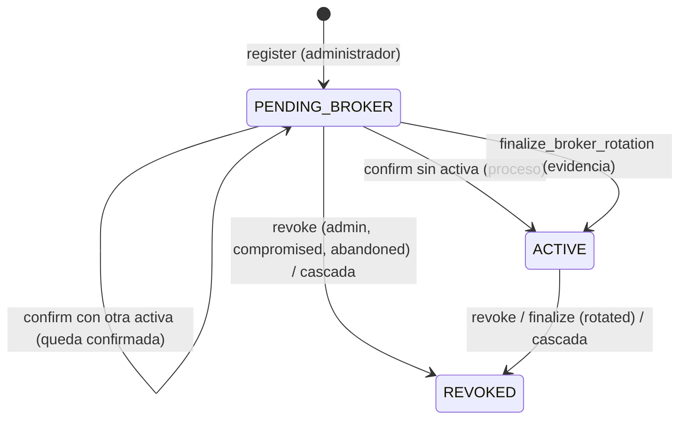

# FLESPI-01 — Credenciales de broker por gateway

- **Etapa:** FLESPI-01 (ADR-FLESPI-00)
- **Estado:** modelo, servicios de dominio, contrato del proveedor y eventos de
  auditoría implementados y probados en MariaDB 11.8.8 desechable. **Sin
  integración con Flespi**: no existe adaptador real, ningún proveedor ni
  verificador está registrado como confiable y, fuera de las pruebas, ninguna
  credencial puede confirmarse ni rotarse.
- **Fecha:** 2026-11-17

## 1. Propósito

Representar la credencial MQTT individual (token ACL de 64 caracteres, usado
como usuario MQTT) que un proveedor externo emite para cada gateway, con Django
como autoridad del estado, del historial y de la auditoría.

## 2. Componentes

| Componente | Archivo |
|---|---|
| Modelo `BrokerCredential` (`iot_broker_credentials`) | `apps/iot/models.py`, `migrations/0021_broker_credential.py` |
| Servicios de dominio | `apps/iot/services/broker_credentials.py` |
| Contrato del proveedor y de la evidencia | `apps/iot/brokers/provider.py` |
| Huella del secreto | `apps/iot/gateway_credentials.py` (`broker_secret_fingerprint`) |
| Serializador de lectura (sin ruta HTTP) | `apps/iot/api/serializers.py` (`BrokerCredentialSerializer`) |
| Eventos de auditoría | `apps/trazabilidad/models.py`, `trazabilidad/0013` |
| Cascada al desactivar el gateway | `apps/iot/services/devices.py` |
| Dobles de prueba | `apps/iot/tests/fakes/broker_provider.py` |

## 3. Estados

`revoked` es terminal (servicio + `CHECK iot_bcred_state_ck`). Una credencial
nueva es otra fila con `version` mayor (`UNIQUE(gateway, provider, version)`).
Como mucho una pendiente y una activa por gateway (`pending_slot`,
`active_slot` con `UNIQUE`; MariaDB admite varios NULL).

## 4. Operaciones

| Operación | Quién | Reglas |
|---|---|---|
| `register_pending_broker_credential` | Administrador | Gateway activo; sin otra pendiente (409). Puede coexistir con la activa |
| `confirm_broker_credential(provider, …, process_id)` | Proceso backend | El servicio consulta al proveedor; la confirmación no es un argumento. Sin activa: activa. Con activa: solo confirma |
| `finalize_broker_rotation(verifier, reason)` | Administrador | Exige pendiente confirmada y evidencia de un verificador confiable de que el gateway usa la credencial nueva. Revoca la anterior (`rotated`) y activa la nueva en una transacción |
| `revoke_broker_credential(version, cause)` | Administrador | `admin`, `compromised`; `abandoned` solo para la pendiente. Solo local |
| Cascada en `deactivate_gateway` | Interno | Revoca pendiente y activa (`gateway_deactivated`), un evento por credencial; el evento de desactivación no cambia |
| `get_active_broker_credential`, `list_broker_credentials` | Integrante activo | Sin secretos ni huellas |

Orden de bloqueo: Farm → FarmMembership → Gateway → credenciales de gateway →
credenciales de broker (el proceso omite FarmMembership).

## 5. Confianza de confirmaciones y evidencias

- No son pruebas criptográficas: un objeto del mismo proceso no puede probar su
  origen. Por eso los servicios **obtienen** la confirmación del proveedor y la
  evidencia del verificador; nunca las reciben como datos.
- Solo se aceptan tipos registrados en `TRUSTED_PROVIDER_TYPES` /
  `TRUSTED_EVIDENCE_VERIFIER_TYPES`, **vacíos en FLESPI-01**.
- Los dobles (`AGROTECH_TEST_DOUBLE = True`) solo con
  `settings.IOT_BROKER_TEST_DOUBLES_ALLOWED is True`, ajuste que no existe en
  `config.settings` ni se lee del entorno. Quedan con
  `confirmation_origin = test_double`.
- Sin ruta HTTP: el frontend no puede confirmar, activar ni finalizar.
- Repetición: `confirmation_ref`, `secret_fingerprint` y
  `activation_evidence_ref` son `UNIQUE`; además se comprueban antes de
  escribir.

## 6. Secretos y `token_id`

- `secret_fingerprint` = `HMAC-SHA256(GATEWAY_CREDENTIAL_HMAC_KEY,
  "agrotech:gw-broker-cred:v1:{uid}:{secreto}")`, distinto del dominio `gws_`.
  No usa la clave de identidad del broker.
- El `token_id` del proveedor **no se guarda** (política de BUILD-FLESPI-02).
  `BrokerIdentity` y sus huellas no se modificaron.
- Auditoría: `bcred_id`, `gateway_uid`, `provider`, `version`, `state`,
  `confirmed`, `revocation_cause` y metadatos operativos. Nunca secreto ni
  huella. Las claves evitan `credential`, `token`, `secret` y `session`, que
  `record_audit_event` rechaza.

## 7. Eventos

| Evento | Cuándo | Actor |
|---|---|---|
| `iot_broker_credential_registered` | Registro | Administrador |
| `iot_broker_credential_confirmed` | El proveedor confirmó (`metadata.activated` indica si además se activó) | `None` + `metadata.process_id` |
| `iot_broker_credential_activated` | `mode=initial` (proceso) o `mode=rotation` (administrador + evidencia) | Proceso o administrador |
| `iot_broker_credential_revoked` | Revocación manual, `rotated` o cascada (`metadata.cause`) | Administrador |

## 8. Migraciones

- `iot.0021_broker_credential`: crea la tabla; barrera de reversión como
  primer paso inverso (`IOT_ALLOW_DESTRUCTIVE_HISTORY_ROLLBACK`).
- `trazabilidad.0013_alter_auditevent_event_type`: solo opciones; reversible.
- Perfiles de prueba desechables actualizados para el grafo nuevo.
- No se aplicaron en ninguna base persistente.

## 9. Coexistencia con componentes previos

- La ingesta sigue exigiendo una `GatewayCredential` vigente
  (`services/ingestion.py`): un gateway Flespi la necesita hasta FLESPI-03/05.
  No hay vínculo entre ambas credenciales.
- `BrokerIdentity` admite una sola identidad activa: durante una coexistencia
  real de tokens, el veredicto en modo `record` daría `mismatch` para uno de
  ellos. Sin efecto hoy (`enforce` bloqueado); debe resolverse antes de
  habilitarlo.

## 10. Pendiente

| Fase | Pendiente |
|---|---|
| FLESPI-03 | Adaptador real, registro como confiable, verificación contra la API (token existe, habilitado, cuenta, ACL del topic), referencia persistente al token compatible con la política del `token_id` (alternativas: etiqueta con `correlation_id` o búsqueda por huella en `BrokerIdentityFingerprint`), creación con outbox, revocación en el proveedor |
| FLESPI-04/05 | Verificador de uso de la credencial nueva, aprovisionamiento del gateway, desconexión de sesión al revocar, vínculo con `GatewayCredential`/ingesta |
| Posterior | Expiración (`ttl`) cuando la política esté decidida; ruta HTTP de administración |
